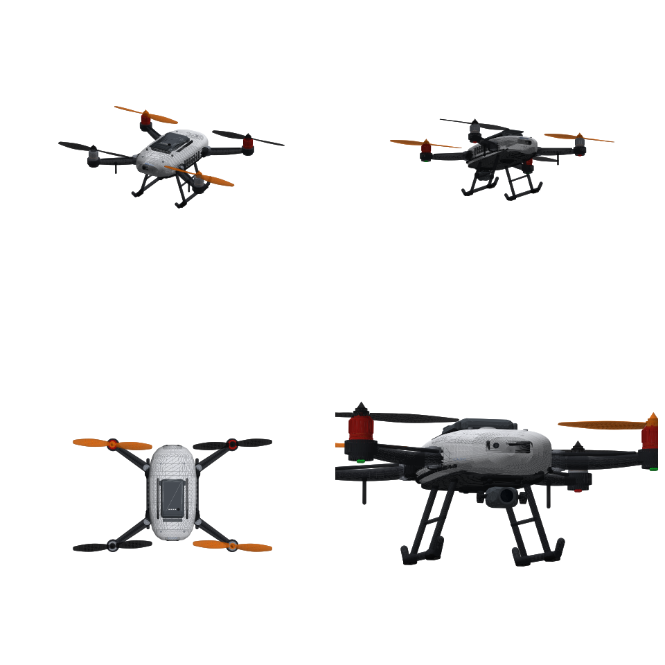

# Quadcopter (Roblox Studio, .glb)

`Quadcopter.glb` — детализированная модель квадрокоптера (~50k треугольников, 38 частей, каждая < 6k треугольников).



## Импорт в Roblox Studio
1. **Avatar → Import 3D** (или File → Import 3D) → выбрать `Quadcopter.glb`.
2. Оставить иерархию (Model), включить импорт материалов/цветов.
3. Размер: размах ≈ 2.06 × 0.62 × 1.18 стада (единица = 1 стад). Масштабируйте через `Model:ScaleTo()` при необходимости.

Перед модели смотрит в −Z (LookVector), верх +Y.

## Части
| Узел | Описание |
|---|---|
| `Propeller_FL/FR/RL/RR` | **Винты — отдельные MeshPart**, центр детали на оси вала мотора. Оранжевые — CCW, чёрные — CW |
| `Motor_*`, `Motor_Windings_*` | Моторы (колокол с рёбрами охлаждения, спицы, винты крепления, обмотки) |
| `Arm_*`, `Arm_Hinge_*` | Сужающиеся лучи с шарнирами складывания и гондолами моторов |
| `LED_*` | Навигационные огни (спереди зелёные, сзади красные), `Status_Light` |
| `Body_Shell`, `Body_Trim` | Корпус, решётки вентиляции, датчики препятствий, нижняя панель |
| `Battery`, `Battery_Button`, `Battery_Level_LEDs` | Съёмный аккумулятор с защёлками и индикатором заряда |
| `Gimbal`, `Camera`, `Lenses` | 3-осевой подвес с демпферами, камера, стёкла сенсоров |
| `GPS_Module`, `Antennas`, `Screws` | GPS, антенны, крепёж |
| `Landing_Gear`, `Landing_Gear_Pads` | Шасси с резиновыми накладками |

## Вращение винтов
Положите `PropellerSpin.server.lua` как Script внутрь импортированной модели — винты будут крутиться в правильных направлениях (через Motor6D к `Body_Shell`).

## Пересборка
```
pip install trimesh numpy networkx
python generate_quadcopter.py
```
